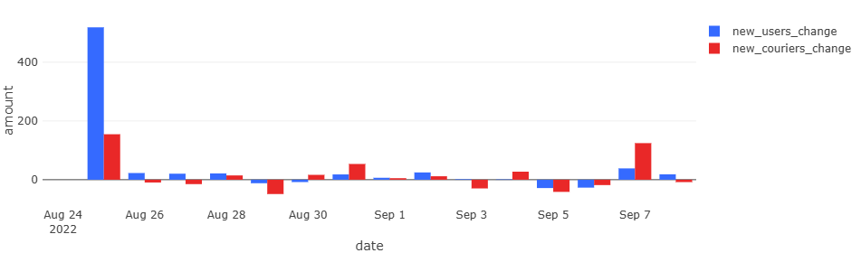
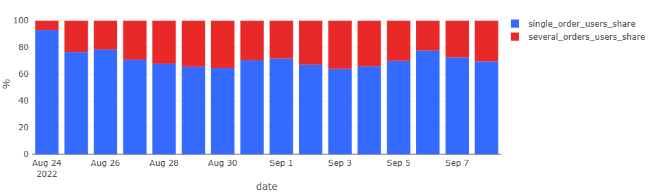
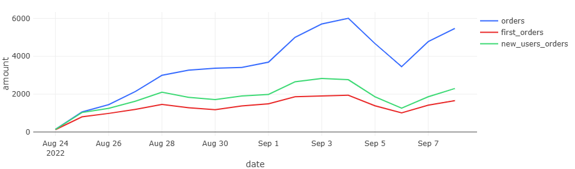
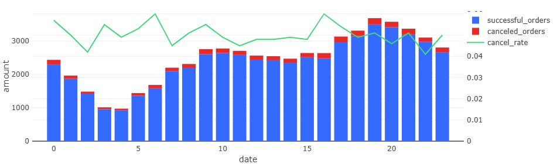

# Пет - проект: Анализ поведения пользователей, курьеров и заказов по данным тренажёра Karpov.courses
## Стек: SQL (PostgreSQL), Redash
### Цель: отработка написания SQL-запросов: как из сырых  табличных данных считать бизнес-метрики и визуализировать их в Redash.
**Описание и основные выводы:** Все данные были взяты <ins>с бесплатного курса «Симулятор SQL» от karpovcourses</ins>. В ходе работы были рассмотрены различные метрики развития работы онлайн-площадки, где пользователи могут оформлять и отменять заказы. Курьеры в свою очередь принимали и доставляли эти заказы. Также есть таблица products, содержащая id и название товаров, которые можно заказать на сайте сервиса. Период действий в таблице 25 августа 2022–06 сентября 2022. На основе таблиц было проанализировано насколько быстро растет аудитория сервиса (курьеры и пользователи). Отдельно было рассмотрены частота заказов среди пользователя – как часто человек совершает несколько заказов в день. Дополнительно была рассмотрена динамика первых покупок пользователями среди общего числа заказов. Наконец была изучена почасовая нагрузка на сервис интернет – магазина.  
Рассмотрим детальнее полученные графики.   
Ниже представлен дашборд с графиками по работе.  
  
**График 1: Прирост новы пользователей и курьеров по дням**  
>25 августа 2022 года – резкий всплеск  (старт функционирования сервиса). Далее прирост затухает. Отрицательные данные появляются в связи с приходом меньшего числа курьеров/ пользователей относительно прошлого дня.
  
  
**График 2: Доли пользователей с одним и несколькими заказами**  
 >Согласно данным, большинство пользователей совершают покупку единожды. Доля пользователей, совершающих сразу несколько покупок составляет меньше 30%. Это говорит о низкой конверсии.
   

**График 3: Тренды общего числа заказов, первых заказов и заказов новых пользователей**   
>Видно, что часть заказов, которые оформляются на сайте – это первый заказы пользователей, причем большинство из них новых пользователей. Всплеск наблюдается 3 сентября 2022 года – это суббота, что объясняет рост не только числа новых пользователей, но и заказов в целом, ввиду выходного дня. 
   

**График 4: Почасовая нагрузка на сервис и доля отмен**  
>Видно, что пик активности на сайте (оформление и отмена заказов) после работы (относительно рабочего времени 9–18), т.е. после 18 часов. При этом процент доля отменённых заказов держится в диапазоне 0.042–0.06, те порядка 5%, что является нормальной долей отмен. Наблюдается локальный всплеск в доле отменённых заказов в промежутке 03–07 часов – возможно аномалия изучаемых данных.  
   
